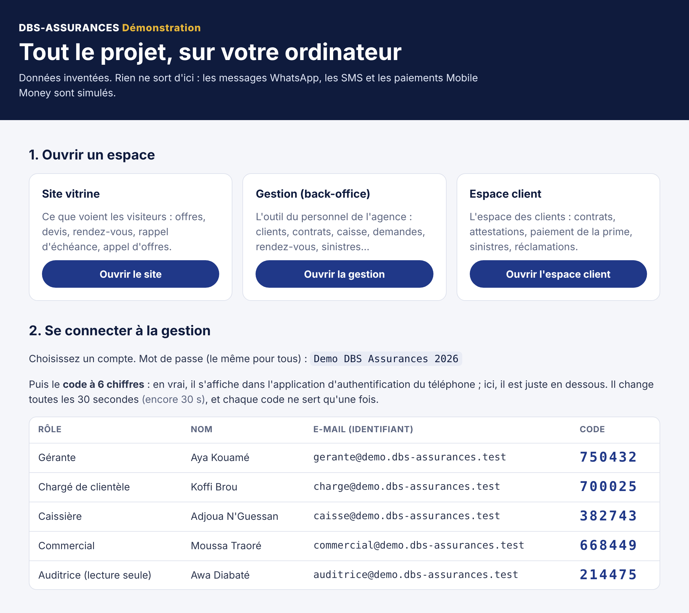

# Lancer le projet sur votre ordinateur, pas à pas

Ce guide est écrit pour quelqu'un qui n'est pas informaticien. À la fin, vous aurez sur votre ordinateur **tout le projet DBS-ASSURANCES** :

- le **site vitrine** ;
- la **gestion**, c'est-à-dire l'outil du personnel (back-office) ;
- l'**espace client**.

Le tout est rempli de données d'exemple, et vous pourrez essayer chaque espace autant que vous voulez.

- **Une seule fois :** installer deux logiciels gratuits, puis récupérer le projet (étapes 1 et 2).
- **À chaque fois :** un double-clic sur `demarrer`, puis tout s'ouvre dans votre navigateur (étape 3).

> Tout ce que vous voyez dans cette démonstration est **inventé**, et **rien ne sort de votre ordinateur**.
>
> Aucun message WhatsApp ni SMS n'est envoyé, aucun paiement n'est débité. N'y saisissez jamais les données d'un vrai client.

## Ce qu'il vous faut

| Outil | À quoi il sert | Où le trouver |
| --- | --- | --- |
| **Docker Desktop** | Il fait tourner le projet (base de données, serveurs) dans des « boîtes » isolées, sans rien installer d'autre sur l'ordinateur. Gratuit pour un usage personnel et pour les petites entreprises, selon les conditions de Docker. | [docker.com/products/docker-desktop](https://www.docker.com/products/docker-desktop/) |
| **GitHub Desktop** | Il récupère le projet, puis ses mises à jour en un clic. | [desktop.github.com](https://desktop.github.com/) |
| **Google Chrome**, **Microsoft Edge** ou **Firefox** | Pour ouvrir les espaces. | Souvent déjà installé |

L'ordinateur doit avoir :

- Windows 10 ou 11 (64 bits), ou un Mac récent ;
- de préférence 8 Go de mémoire ;
- une dizaine de Go d'espace libre ;
- une connexion à internet pour la première fois.

## Étape 1 — Installer Docker Desktop (une seule fois)

**Sous Windows**

1. Sur [docker.com/products/docker-desktop](https://www.docker.com/products/docker-desktop/), téléchargez « Docker Desktop for Windows ».
2. Lancez le fichier téléchargé et gardez les choix proposés. Laissez cochée la case « WSL 2 » si elle apparaît.
3. Redémarrez l'ordinateur si on vous le demande.
4. Ouvrez **Docker Desktop**, acceptez les conditions d'utilisation. Vous pouvez passer la création de compte : elle n'est pas nécessaire.
5. Attendez qu'apparaisse **« Engine running »**, en vert, en bas à gauche de la fenêtre de Docker Desktop.

**Sur Mac**

1. Regardez le type de votre Mac : menu Pomme, puis « À propos de ce Mac ». La ligne « Puce » indique Apple, la ligne « Processeur » indique Intel.
2. Téléchargez la version correspondante sur le même site.
3. Ouvrez le fichier, glissez Docker dans le dossier Applications, puis ouvrez Docker et acceptez.
4. Attendez **« Engine running »**.

> Astuce : dans les réglages de Docker Desktop, cochez « Start Docker Desktop when you sign in to your computer ». Docker sera ouvert d'office à chaque démarrage.

## Étape 2 — Récupérer le projet (une seule fois)

**Avec GitHub Desktop (conseillé : les mises à jour se font ensuite en un clic)**

1. Installez GitHub Desktop depuis [desktop.github.com](https://desktop.github.com/).
2. Ouvrez-le, puis connectez-vous avec le compte GitHub qui a accès au projet.
3. Menu **File**, puis **Clone repository**, onglet **GitHub.com**.
4. Choisissez **doumby87-stack/DBS-ASSURANCES**, puis l'endroit où le ranger (par exemple dans Documents), puis **Clone**.
5. En haut, dans **Current branch**, choisissez la branche à essayer :
   - tant que la PR n° 14 n'est pas fusionnée, choisissez **`claude/magical-cori-wmv30p`** : c'est elle qui contient cette démonstration ;
   - ensuite, choisissez **`main`**.

**Sans GitHub Desktop**

1. Sur la page du projet sur github.com, choisissez la branche.
2. Bouton vert **Code**, puis **Download ZIP**.
3. Décompressez le fichier, par exemple dans Documents.

Pour une mise à jour, il faudra télécharger de nouveau le fichier ZIP.

## Étape 3 — Lancer la démonstration (à chaque fois)

1. **Ouvrez Docker Desktop**, puis attendez « Engine running ».
2. **Ouvrez le dossier du projet.** Dans GitHub Desktop, menu **Repository**, puis **Show in Explorer** (Windows) ou **Show in Finder** (Mac). Ouvrez ensuite le dossier **`demo`**.
3. **Double-cliquez sur le fichier de démarrage :**
   - **Windows :** `demarrer.bat`. Si Windows affiche « Windows a protégé votre ordinateur », cliquez sur « Informations complémentaires », puis sur « Exécuter quand même ».
   - **Mac :** la première fois, faites un clic droit sur `demarrer.command`, puis **Ouvrir**, puis **Ouvrir**. C'est la protection habituelle de macOS pour un fichier téléchargé. Les fois suivantes, un double-clic suffit.
4. **Patientez.** Une fenêtre noire montre l'avancement :
   - la **première fois**, comptez **5 à 15 minutes**, le temps de tout télécharger et préparer ;
   - **ensuite**, une minute environ.
5. La page **http://localhost:8080** s'ouvre toute seule dans votre navigateur. Si elle ne s'ouvre pas, tapez cette adresse vous-même.

Cette page d'accueil réunit tout ce qu'il faut pour tester : les liens vers chaque espace, les comptes de démonstration, et les codes de connexion, qui s'affichent en direct.

## Étape 4 — Essayer chaque espace

| Espace | Adresse | Pour se connecter |
| --- | --- | --- |
| Page d'accueil de la démonstration | http://localhost:8080 | — |
| Site vitrine | http://localhost:4321 | Aucune connexion : c'est le site public |
| Gestion (personnel de l'agence) | http://localhost:4173 | E-mail, mot de passe, puis code à 6 chiffres (voir ci-dessous) |
| Espace client | http://localhost:4174 | Numéro de téléphone, puis code reçu (voir ci-dessous) |

**Se connecter à la gestion**

1. Sur la page d'accueil, choisissez un compte : gérante, chargé de clientèle, caissière, commercial ou auditrice. Chaque rôle ne voit que ce qui le concerne.
2. Dans la gestion, saisissez son **e-mail**, puis le mot de passe, le même pour tous : **`Demo DBS Assurances 2026`**.
3. Saisissez le **code à 6 chiffres** affiché en face du compte sur la page d'accueil.
   - En vrai, ce code vient de l'application d'authentification du téléphone.
   - Il change toutes les 30 secondes, et chaque code ne sert qu'une fois. S'il est refusé, attendez le suivant.

**Se connecter à l'espace client**

1. Dans l'espace client, saisissez un des numéros listés sur la page d'accueil (par exemple **07 08 09 10 11**, Koné Mariam), puis cliquez sur **Recevoir mon code**.
2. Le code, qui partirait normalement sur WhatsApp, apparaît sur la page d'accueil. Recopiez-le.

**Quelques essais**

- **Une demande du site.** Sur le site, prenez un rendez-vous ou demandez un devis. Connecté en gérante, retrouvez-la dans la gestion, rubrique « Rendez-vous » ou « Demandes du site ».
- **Payer une prime en ligne.** Dans l'espace client, connectez-vous comme Koné Mariam, puis payez une partie de sa prime. Le paiement est simulé. Il apparaît dans la gestion : sur son contrat, et dans « Caisse ».
- **La flotte d'un transporteur.** Dans l'espace client, connectez-vous comme Awa Kouassi (07 01 02 03 04) : camions, documents à renouveler, attestation à télécharger.
- **Les droits de chacun.** Connectez-vous comme caissière, puis comme auditrice : chacun ne voit que ce que son rôle permet.

## Arrêter, relancer, repartir de zéro

Les fichiers sont dans le dossier `demo`. Sous Windows, ils se terminent par `.bat` ; sur Mac, par `.command`.

| Pour… | Double-cliquez sur | Ce qui se passe |
| --- | --- | --- |
| Arrêter | `arreter` | Tout s'arrête. Les données sont gardées pour la prochaine fois. |
| Relancer | `demarrer` | Reprend là où vous en étiez. |
| Repartir de zéro | `reinitialiser` | Après confirmation, efface tout ce que vous avez saisi et remet les données d'exemple. |

Fermer Docker Desktop arrête aussi la démonstration.

## Après une mise à jour du projet

1. Dans GitHub Desktop, cliquez sur **Fetch origin**, puis sur **Pull origin** s'il apparaît.
2. Double-cliquez sur `demarrer`. Ce qui a changé est reconstruit tout seul, en quelques minutes.

Si la structure de la base de données a changé, la démonstration repart d'elle-même des données d'exemple.

## En cas de problème

| Ce que vous voyez | Que faire |
| --- | --- |
| « Docker Desktop n'est pas ouvert, ou pas encore prêt » | Ouvrez Docker Desktop, attendez « Engine running », puis relancez `demarrer`. |
| Docker Desktop ne démarre pas sous Windows (message sur « WSL » ou la « virtualisation ») | Faites les mises à jour de Windows et redémarrez. Si le message parle de virtualisation, elle doit être activée dans le BIOS de l'ordinateur : demandez à la personne qui s'occupe de votre matériel. |
| « port is already allocated » ou « address already in use » | Un autre programme utilise déjà l'une des adresses de la démonstration (ports 8080, 3000, 4173, 4174 ou 4321). Fermez-le, ou redémarrez l'ordinateur, puis relancez `demarrer`. |
| « Ce site est inaccessible » | Attendez une minute et actualisez la page. Dans Docker Desktop, rubrique **Containers**, les éléments de **dbs-demo** doivent être en marche. |
| Le code de la gestion est refusé | Chaque code ne sert qu'une fois : attendez le suivant, sur la page d'accueil. Après 5 erreurs de suite, le compte se bloque 15 minutes : c'est une protection. Patientez, prenez un autre compte, ou utilisez `reinitialiser`. |
| Aucun code n'apparaît pour l'espace client | Vérifiez que le numéro saisi est exactement celui de la page d'accueil. Un code vaut 10 minutes : demandez-en un autre si besoin. |
| Sur Mac : « impossible d'ouvrir… développeur non identifié » | Clic droit sur le fichier, **Ouvrir**, puis **Ouvrir**. |
| Autre chose | Dans Docker Desktop, rubrique **Containers**, ouvrez **dbs-demo**, puis **demo-1**, onglet **Logs**. Copiez les dernières lignes et envoyez-les à la personne qui développe le projet. |

## Pour les développeurs

- **Ce que fait la démonstration :** [demo/README.md](demo/README.md).
- **Lancer chaque application à part, avec rechargement automatique :** [API](apps/api/README.md), [gestion](apps/admin/README.md), [espace client](apps/portail/README.md), [site](apps/site-vitrine/LISEZMOI.md).
- **Tests :** [base de données](database/README.md), et la section « Tests » de chaque application.
