# Modèle de données

Schéma défini dans [`database/migrations`](../../database/migrations). Montants en francs CFA, entiers.

```mermaid
erDiagram
  UTILISATEURS ||--o{ CLIENTS : "apporte"
  CLIENTS ||--o{ VEHICULES : "possède"
  CLIENTS ||--o{ CONTRATS : "souscrit"
  CONTRATS ||--o{ CONTRATS_VEHICULES : "couvre"
  VEHICULES ||--o{ CONTRATS_VEHICULES : "est couvert par"
  CONTRATS ||--o{ ENCAISSEMENTS : "est payé par"
  ENCAISSEMENTS |o--o| ENCAISSEMENTS : "contre-passe"
  REVERSEMENTS ||--o{ ENCAISSEMENTS : "regroupe"
  CONTRATS ||--o{ SINISTRES : "donne lieu à"
  CONTRATS |o--o| CONTRATS : "renouvelle"
  CLIENTS ||--o{ DEVIS : "demande"
  DEVIS |o--o| CONTRATS : "aboutit à"
  CLIENTS ||--o{ ECHANGES : "historique"
  UTILISATEURS ||--o{ CLOTURES_CAISSE : "clôture sa caisse"
  TAUX_COMMISSION }o--|| CONTRATS : "par branche"
  VEHICULES |o--o{ SINISTRES : "concerné par"
  CLIENTS ||--o{ CONSENTEMENTS : "accepte ou refuse"
  CLIENTS ||--o{ GESTIONNAIRES_PORTAIL : "accède au portail par"
  CONTRATS_VEHICULES ||--o| ATTESTATIONS_VEHICULES : "attestée par"
  CONTRATS ||--o{ PAIEMENTS_EN_LIGNE : "payé en ligne par"
  PAIEMENTS_EN_LIGNE |o--o| ENCAISSEMENTS : "encaissé par"
  GESTIONNAIRES_PORTAIL ||--o{ PAIEMENTS_EN_LIGNE : "commence"
  GESTIONNAIRES_PORTAIL |o--o{ SINISTRES : "déclare en ligne"
  SINISTRES ||--o{ PIECES_SINISTRES : "photos et documents"
  CLIENTS ||--o| IDENTIFICATIONS_CLIENTS : "identifié par"
  CLIENTS ||--o{ DIRIGEANTS_BENEFICIAIRES : "dirigé, possédé par"
  CLIENTS ||--o{ JUSTIFICATIFS_IDENTIFICATION : "justifié par"
  CLIENTS |o--o{ RECLAMATIONS : "réclame"
  CONTRATS |o--o{ RECLAMATIONS : "concerné par"
  UTILISATEURS ||--o{ FORMATIONS_PERSONNEL : "formé"
  CLIENTS ||--o{ RELANCES : "reçoit"
  CONTRATS ||--o{ AVENANTS_FLOTTE : "modifié par"
  AVENANTS_FLOTTE ||--|{ AVENANTS_FLOTTE_LIGNES : "détaille"
  VEHICULES ||--o{ AVENANTS_FLOTTE_LIGNES : "incorporé ou retiré"
  AVENANTS_FLOTTE |o--o| AVENANTS_FLOTTE : "annule"
  VEHICULES ||--o{ ANNONCES_DOCUMENTS : "documents rappelés"
  RELANCES ||--o{ ANNONCES_DOCUMENTS : "annonce"
  DEMANDES_SITE |o--o| DEVIS : "devient"
  DEMANDES_SITE }o--o| CLIENTS : "rattachée à"
  DEMANDES_SITE ||--o| PIECES_DEMANDES_SITE : "carte grise jointe"
  CONTRATS |o--o{ RELANCES : "échéance"
  DEVIS |o--o{ RELANCES : "sans réponse"
  SINISTRES |o--o{ RELANCES : "avancement"

  UTILISATEURS {
    uuid id
    text email
    role_utilisateur role
    boolean actif
  }
  CLIENTS {
    uuid id
    type_client type
    text nom
    text telephone "E.164"
    bytea piece_identite_chiffree
    uuid apporteur_id
  }
  VEHICULES {
    uuid id
    text immatriculation "unique"
    date echeance_visite_technique
    date echeance_vignette
    date echeance_carte_transport
  }
  CONTRATS {
    uuid id
    text numero_police "SanlamAllianz"
    branche branche
    date date_effet
    date date_echeance
    bigint prime_ttc
    bigint prime_nette "base des commissions"
    statut_contrat statut "en vigueur dès la prime payée"
  }
  CONTRATS_VEHICULES {
    uuid id
    text numero_attestation "ASACI"
    date ajoute_le "une ligne par période : un véhicule réintégré en a plusieurs"
    date retire_le
    bigint prime_vehicule "base du prorata d'un retrait"
    uuid incorpore_par "avenant qui a ouvert la période"
    uuid retire_par "avenant qui l'a fermée"
  }
  ENCAISSEMENTS {
    uuid id
    bigint numero_recu "sans trou, attribué par la base"
    bigint montant "négatif = contre-passation"
    mode_paiement mode
    text reference_externe
    timestamptz encaisse_le
    uuid encaisse_par "caissier ; vide pour un paiement en ligne (hors caisse)"
    uuid paiement_en_ligne_id
    text payeur_tiers "qui paie, si ce n'est pas le client : alerte au gérant"
  }
  REVERSEMENTS {
    uuid id
    text numero_bordereau "BR-année-numéro, par la base"
    uuid prepare_par
    uuid valide_par "différent de prepare_par"
    date verse_le
    timestamptz annule_le "avant validation seulement"
  }
  CLOTURES_CAISSE {
    uuid id
    bigint numero "sans trou"
    uuid caissier_id
    bigint especes_attendues "calculées par la base"
    bigint especes_comptees
    jsonb billetage
    bigint ecart "justifié s'il n'est pas nul"
    uuid visee_par "différent de caissier_id"
  }
  TAUX_COMMISSION {
    branche branche
    numeric taux "en %"
    date applicable_du
  }
  RELEVES_COMMISSIONS {
    date mois "un par mois"
    bigint montant_declare
    text reference
  }
  SINISTRES {
    uuid id
    date survenu_le
    date declare_le
    nature_sinistre nature
    statut_sinistre statut
    text circonstances "récit du client, visible par lui"
    text description "note interne de l'agence"
    uuid declare_par_gestionnaire "déclaré en ligne"
  }
  DEVIS {
    uuid id
    branche branche
    origine_devis origine
    bigint prime_proposee
    statut_devis statut
    text motif_refus "obligatoire si refusé"
  }
  ECHANGES {
    uuid id
    canal_echange canal
    text resume
    timestamptz survenu_le
  }
  CONSENTEMENTS {
    uuid id
    canal_relance canal "whatsapp, sms"
    boolean accorde
    source_consentement source "agence ou réponse STOP"
    text preuve "comment le client l'a exprimé"
    timestamptz enregistre_le
  }
  AVENANTS_FLOTTE {
    uuid id
    bigint numero "continu, attribué par la base"
    nature_avenant nature "mouvement ou annulation"
    date date_effet "la même pour tous ses véhicules"
    bigint montant "somme des lignes, calculée par la base"
    uuid annule_avenant_id "avenant défait par une annulation"
    text motif "obligatoire pour une annulation"
  }
  GESTIONNAIRES_PORTAIL {
    uuid id
    text telephone "reçoit le code ; un accès actif par numéro"
    role_gestionnaire role "titulaire ou collaborateur"
    boolean actif
    timestamptz derniere_connexion_le
  }
  ATTESTATIONS_VEHICULES {
    bytea contenu_chiffre "PDF chiffré (AES-256-GCM)"
    bytea empreinte "SHA-256 du PDF"
    analyse_piece etat_analyse "jamais infectée"
  }
  PAIEMENTS_EN_LIGNE {
    text reference "DBS-00000001, transmise au prestataire"
    bigint montant "multiple de 5"
    text prestataire
    statut_paiement_en_ligne statut "initié, en attente, accepté, refusé, abandonné, à régulariser"
    text moyen "Wave, Orange Money, MTN MoMo, Moov Money"
    text motif "à régulariser : pourquoi, puis ce que l'agence a fait"
  }
  IDENTIFICATIONS_CLIENTS {
    niveau_risque niveau_risque "faible, normal, élevé"
    boolean personne_politiquement_exposee "risque élevé d'office"
    bytea numero_piece_chiffre "chiffré par l'API ; 4 derniers caractères en clair"
    date verifiee_le "original vu, par une fonction dédiée"
    date prochaine_revue "3, 2 ou 1 an selon le risque"
  }
  DIRIGEANTS_BENEFICIAIRES {
    text nom
    boolean est_dirigeant
    boolean est_beneficiaire_effectif
    numeric part_capital
    timestamptz retire_le "retrait, jamais d'effacement"
  }
  RECLAMATIONS {
    text reference "REC-2026-0001, par la base"
    canal_reclamation canal "guichet, téléphone… espace client"
    date echeance_reponse "10 jours ouvrés"
    text reponse "et son issue"
    text escalade "compagnie, Direction des Assurances"
  }
  FACTURES_FNE {
    text numero_fne "attribué par la plateforme de la DGI"
    date mois "commissions : une par mois"
    timestamptz annulee_le "avoir, avec motif"
  }
  PIECES_SINISTRES {
    text nom_fichier
    text type_contenu "JPEG, PNG ou PDF"
    bytea contenu_chiffre "AES-256-GCM, contexte propre à la pièce"
    analyse_piece etat_analyse "jamais infectée"
  }
  AVENANTS_FLOTTE_LIGNES {
    mouvement_flotte mouvement "incorporation ou retrait"
    bigint prime_vehicule "pour toute la période du contrat"
    integer jours_restants "calculé par la base"
    bigint montant "prorata : positif à l'incorporation, ristourne au retrait"
  }
  ANNONCES_DOCUMENTS {
    text document "visite technique, vignette, carte de transport"
    date echeance
    text etape "j30, j7, echu : une annonce par étape"
  }
  DEMANDES_SITE {
    uuid id
    bigint numero "communiqué au visiteur"
    branche branche
    type_client profil
    text accord_traitement "texte de la case cochée"
    text accord_whatsapp "texte de la case, si cochée"
    bytea empreinte_ip "HMAC, illisible par l'application"
    statut_demande_site statut "nouvelle, convertie, sans suite"
    text motif "obligatoire si sans suite"
  }
  PIECES_DEMANDES_SITE {
    uuid id "entre dans le contexte du chiffrement"
    text type_contenu "JPEG, PNG ou PDF, d'après le contenu"
    integer taille "5 Mo au plus"
    bytea contenu_chiffre "AES-256-GCM"
    bytea empreinte "SHA-256 du fichier"
    analyse_piece etat_analyse "à analyser, saine, infectée (contenu effacé)"
    text signature_detectee "menace trouvée par l'antivirus"
  }
  RELANCES {
    uuid id
    text cle "unique : une relance par étape et par objet"
    type_relance type
    canal_relance canal
    text destinataire "E.164"
    statut_relance statut "à envoyer, envoyée, remise, lue, échec, annulée"
    text identifiant_fournisseur "WhatsApp ou opérateur SMS"
    smallint tentatives
  }
```

## Vues de pilotage

| Vue | Usage |
| --- | --- |
| `app.v_soldes_contrats` | Prime, total encaissé et reste à payer par contrat. |
| `app.v_encaissements_a_reverser` | Primes pas encore versées à la compagnie, date limite et jours restants (30 jours). |
| `app.v_mouvements_caisse` | Encaissements rattachés à la caisse concernée (une contre-passation compte dans la caisse de la personne qui avait encaissé). |
| `app.v_commissions_mensuelles` | Par mois : primes encaissées, commission attendue, relevé de la compagnie, écart. |
| `app.v_echeances_contrats` | Contrats en vigueur, pas encore renouvelés, qui arrivent à échéance dans les 60 jours (ou déjà échus). |
| `app.v_echeances_vehicules` | Visite technique, vignette, carte de transport à renouveler dans les 60 jours. |
| `app.v_sinistres_suivi` | Délai de déclaration et, pour un sinistre corporel, date limite indicative de l'offre. |
| `app.v_consentements` | Dernier choix de chaque client pour chaque canal de relance. |
| `app.v_avenants_flotte` | Avenants de flotte avec leur règlement (les encaissements au-delà de la prime de départ règlent les avenants dans l'ordre) et leur annulation éventuelle. |
| `app.v_relances_dues` | Relances dues aujourd'hui (échéance à J-30, J-15, J-7 et le jour même, contrat expiré depuis moins de 7 jours, devis sans réponse depuis 3 jours, avancement d'un sinistre) qui ne sont pas encore planifiées. |

Toutes les vues appliquent les droits de la personne qui les consulte (`security_invoker`).

Le schéma `portail` (tables `codes_connexion`, `sessions`, `evenements`) n'est accessible que par ses fonctions : codes de connexion (empreinte seule), sessions du portail et journal de ses connexions et téléchargements ([ADR 0011](adr/0011-portail-des-entreprises.md)).

L'état d'une fiche d'identification (`app.etat_identification`) se lit sans aucune donnée d'identité ; la vérification de l'original passe par `app.verifier_identification`. Les alertes de lutte contre le blanchiment (`app.v_alertes`) ne sont lisibles que par le gérant ; les réclamations se traitent par `app.traiter_reclamation`, qui date et signe chaque étape ; les échéances se calculent en jours ouvrés (`app.ajouter_jours_ouvres`) ([ADR 0013](adr/0013-conformite-et-pilotage.md)).

Les paiements en ligne sont préparés et conclus par la base (`portail.preparer_paiement`, `app.conclure_paiement_en_ligne`) : l'encaissement d'un paiement accepté est enregistré sans caissier, hors caisse ; un paiement reçu mais impossible à encaisser reste « à régulariser » par le gérant. Les sinistres déclarés en ligne et leurs pièces passent par `portail.declarer_sinistre` et `portail.joindre_piece_sinistre` ; une pièce ne se modifie ni ne se supprime ([ADR 0012](adr/0012-espace-client-et-paiement-en-ligne.md)).

## À venir

Documents des contrats (stockage de fichiers, tâche 11) ; purge des fiches d'identification à la fin de la durée légale de conservation, une fois celle-ci confirmée.

Les demandes du site n'entrent que par la fonction `app.enregistrer_demande_site`, appelée sans utilisateur connecté par la route publique du formulaire : elle limite les envois par adresse (5 par heure) et par jour (300), et range la carte grise chiffrée dans `app.pieces_demandes_site`, en ajout seul et hors du journal d'audit. Le verdict de l'antivirus ne s'enregistre que par `app.enregistrer_analyse_piece` ; la maintenance de l'API retrouve les pièces à analyser par `app.pieces_a_analyser` et supprime les demandes sans suite depuis 12 mois par `app.purger_demandes_site`, seule à pouvoir supprimer dans ces tables ([ADR 0009](adr/0009-demandes-de-devis-du-site.md)).

Les relances ne sont créées que par le planificateur de l'API, au moyen des fonctions `app.planifier_relances`, `app.prendre_relances_a_envoyer`, `app.enregistrer_envoi`, `app.enregistrer_statut_fournisseur` et `app.enregistrer_desinscription` ([ADR 0007](adr/0007-relances-whatsapp-et-sms.md)).

Les numéros de reçus, de bordereaux et de clôtures viennent de `app.compteurs`, table inaccessible à l'application : seul un déclencheur de la base attribue un numéro, dans la transaction de l'opération. Un paiement refusé ou annulé ne laisse donc aucun trou.
