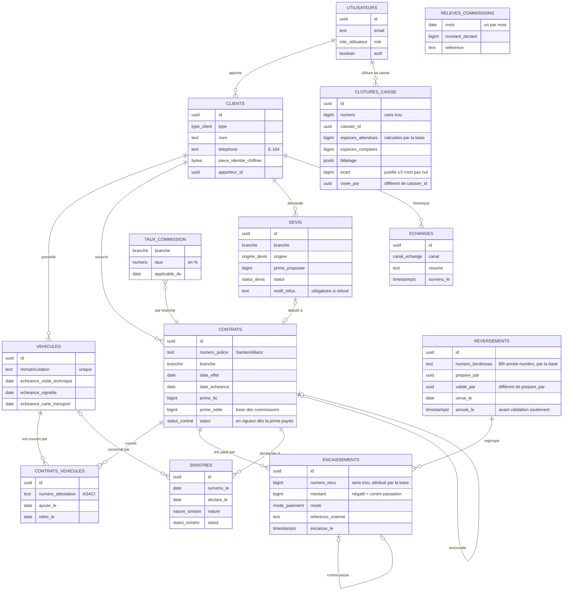

# Modèle de données

Schéma défini dans [`database/migrations`](../../database/migrations). Montants en francs CFA, entiers.

## Vues de pilotage

| Vue | Usage |
| --- | --- |
| `app.v_soldes_contrats` | Prime, total encaissé et reste à payer par contrat. |
| `app.v_encaissements_a_reverser` | Primes pas encore versées à la compagnie, date limite et jours restants (30 jours). |
| `app.v_mouvements_caisse` | Encaissements rattachés à la caisse concernée (une contre-passation compte dans la caisse de la personne qui avait encaissé). |
| `app.v_commissions_mensuelles` | Par mois : primes encaissées, commission attendue, relevé de la compagnie, écart. |
| `app.v_echeances_contrats` | Contrats en vigueur, pas encore renouvelés, qui arrivent à échéance dans les 60 jours (ou déjà échus). |
| `app.v_echeances_vehicules` | Visite technique, vignette, carte de transport à renouveler dans les 60 jours. |
| `app.v_sinistres_suivi` | Délai de déclaration et, pour un sinistre corporel, date limite indicative de l'offre. |

Toutes les vues appliquent les droits de la personne qui les consulte (`security_invoker`).

## À venir

Demandes venues du site (tâche 7), documents (tâche 7), relances et consentements (tâche 6), identification des clients et réclamations (tâche 12), comptes des clients de l'espace en ligne (tâche 9).

Les numéros de reçus, de bordereaux et de clôtures viennent de `app.compteurs`, table inaccessible à l'application : seul un déclencheur de la base attribue un numéro, dans la transaction de l'opération. Un paiement refusé ou annulé ne laisse donc aucun trou.
