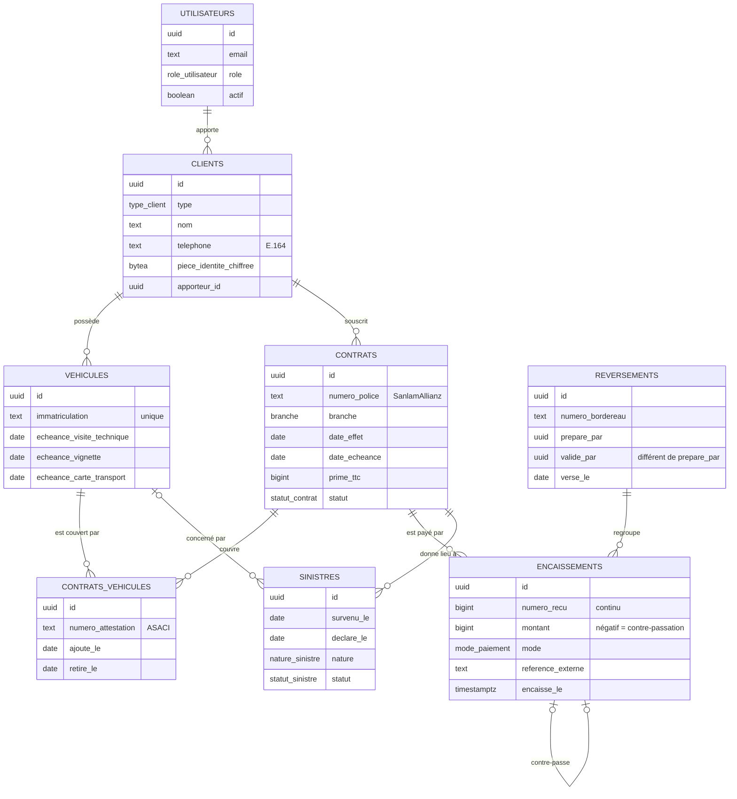

# Modèle de données

Schéma défini dans [`database/migrations`](../../database/migrations). Montants en francs CFA, entiers.

## Vues de pilotage

| Vue | Usage |
| --- | --- |
| `app.v_soldes_contrats` | Prime, total encaissé et reste à payer par contrat. |
| `app.v_encaissements_a_reverser` | Primes pas encore versées à la compagnie, date limite et jours restants (30 jours). |
| `app.v_echeances_contrats` | Contrats en vigueur qui arrivent à échéance dans les 60 jours. |
| `app.v_echeances_vehicules` | Visite technique, vignette, carte de transport à renouveler dans les 60 jours. |
| `app.v_sinistres_suivi` | Délai de déclaration et, pour un sinistre corporel, date limite indicative de l'offre. |

Toutes les vues appliquent les droits de la personne qui les consulte (`security_invoker`).

## À venir

Devis et demandes du site (tâche 7), documents (tâche 7), relances et consentements (tâche 6), commissions (tâche 5), identification des clients et réclamations (tâche 12), comptes des clients de l'espace en ligne (tâche 9).
