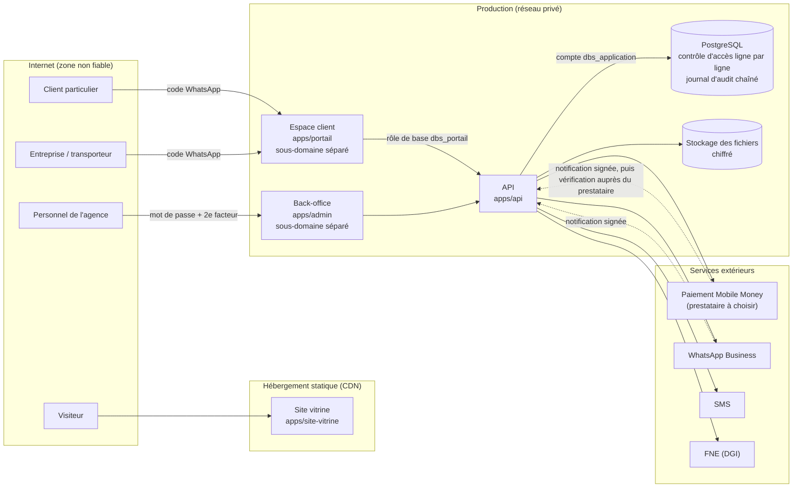

# Vue d'ensemble de l'architecture

## Les briques



## Les principes

1. **Une seule porte vers les données : l'API.** Aucun navigateur ne parle à la base ([ADR 0003](adr/0003-api-seule-porte-d-acces.md)).
2. **Défense en profondeur.** L'API vérifie les droits ; la base les vérifie à nouveau, ligne par ligne, et applique elle-même les règles financières. Une erreur dans l'API ne suffit pas à exposer ou fausser des données ([ADR 0004](adr/0004-securite-dans-la-base.md)).
3. **Fermeture par défaut.** Sans utilisateur authentifié, sans rôle prévu, sans politique écrite : refus.
4. **Rien ne s'efface, tout se trace.** Pas de suppression de données métier ; chaque écriture est consignée dans un journal infalsifiable.
5. **Le site vitrine reste séparé.** Il est statique, ne contient aucune donnée, et sa compromission ne donne accès à rien.
6. **Pas de ressource tierce dans les pages.** Polices, icônes et scripts sont livrés avec chaque application, ce qui permet une politique de sécurité du contenu stricte.
7. **Un seul langage** (TypeScript) du navigateur au serveur, et des règles métier partagées (`packages/domaine`) ([ADR 0002](adr/0002-pile-technique.md)).

## Organisation du dépôt

```
apps/
  site-vitrine/    site public, construit par Astro (seul dist/ est publié)
  api/             API : authentification, droits, règles, intégrations
  admin/           back-office de l'agence
  portail/         espace client : entreprises et particuliers (contrats ou flotte, attestations, paiement, sinistres)
packages/
  domaine/         règles métier partagées (formats, délais, calculs)
  ui/              composants d'interface partagés
database/          schéma PostgreSQL, migrations, tests de sécurité
infra/             environnements, sauvegardes, surveillance
scripts/           outils de vérification
docs/              architecture, sécurité, conformité, métier, feuille de route
.github/           intégration continue, modèles de tickets et de pull requests
```

Choix du dépôt unique : [ADR 0001](adr/0001-depot-unique.md). Modèle de données : [modele-de-donnees.md](modele-de-donnees.md).
