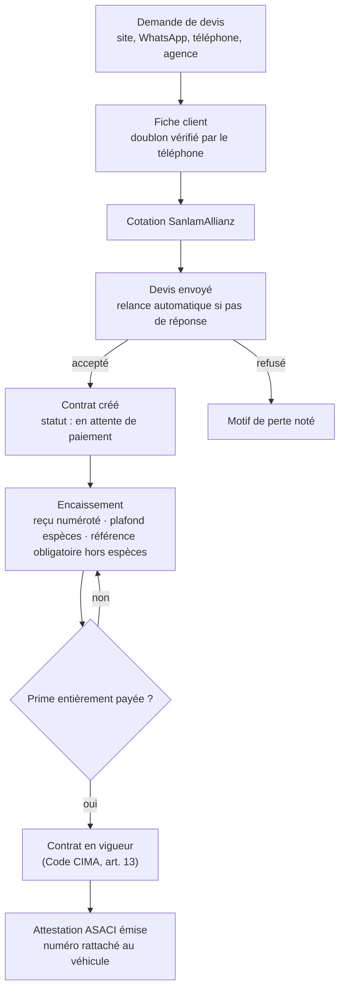
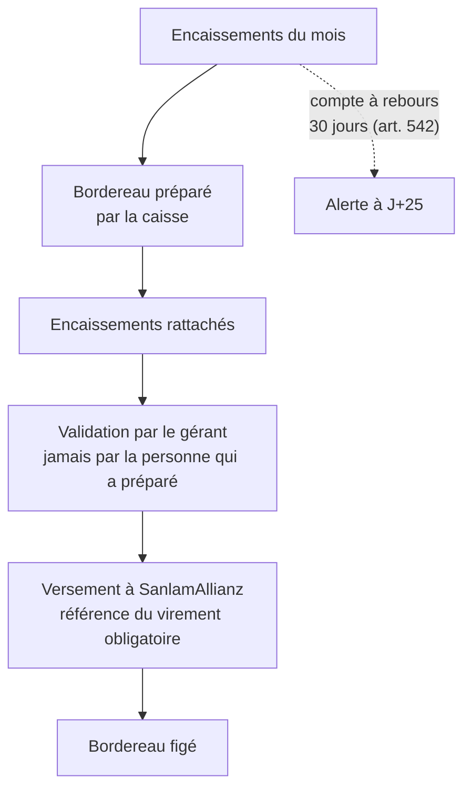
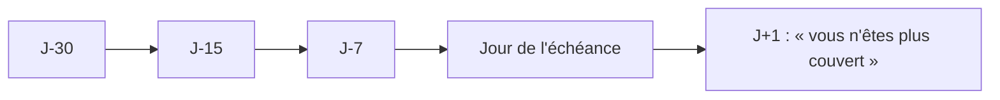
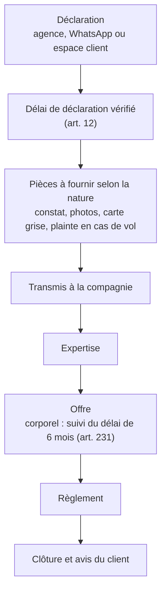

# Processus de l'agence

Les parcours que l'outil doit servir, tels qu'ils sont prévus. Chaque étape indique ce que le système vérifie.

## Du devis à l'attestation

## De l'encaissement au reversement

## Renouvellement

À chaque étape : message WhatsApp (ou SMS), et tâche pour le chargé de clientèle si le client ne répond pas. Pour les flottes, les échéances de visite technique, vignette et carte de transport suivent le même rythme.

## Sinistre

Le client est informé à chaque changement de statut.
